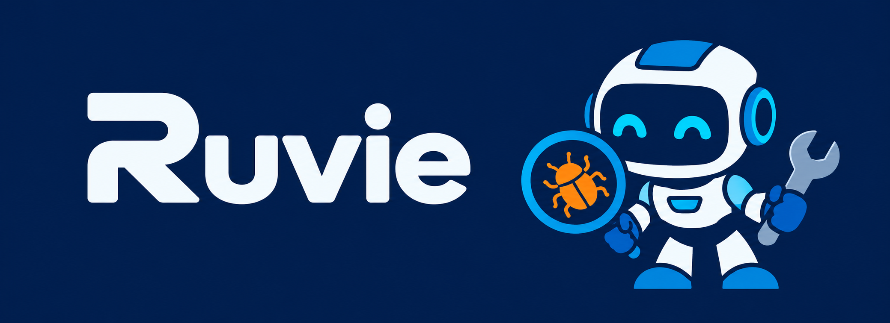

# Ruvie Agent

When employees at Harmony encounter installation, configuration or usage problems
with internal and BIM/CAD software, finding the right guide can take time and
repeated questions add to IT Support's workload. Ruvie Agent helps them find
answers in authorized internal documents and ask questions with source citations,
so they can apply existing troubleshooting guidance more easily.

## Requirements

- PowerShell for the commands below.
- [uv](https://docs.astral.sh/uv/) to install Python 3.11 and backend dependencies;
  a separate Python installation is unnecessary.
- Node.js 22.18+ and npm for the Svelte 5/Vite frontend and its TypeScript tests.
- PostgreSQL with pgvector; the documented database setup uses PostgreSQL 16.
- Docker Desktop with Linux containers if using the documented Docker database;
  Docker is also required for backend database integration tests.
- An embedding provider supporting `baai/bge-m3` with 1024-dimensional cosine
  embeddings, and an OpenAI-compatible LLM provider exposing `GET /models` and
  `POST /chat/completions` for document ingestion and question answering.

## Setup

Run commands in PowerShell from the repository root. Contributors and agents can
find module responsibilities and data flows in
[architecture notes](specs/02-architecture.md).

### Backend

Install uv if missing:

~~~powershell
winget install --id astral-sh.uv -e
~~~

Reopen PowerShell, return to the repository root, then create the environment
and install dependencies. uv downloads Python if needed.

~~~powershell
uv venv --python 3.11 .venv
uv pip install --python .\.venv\Scripts\python.exe -r backend\requirements.txt
~~~

### Frontend

~~~powershell
Set-Location frontend
npm install
Set-Location ..
~~~

### Frontend code checks

`npm install` in `frontend/` installs the pre-commit hook. It formats and lints
staged frontend files only; fix reported lint errors before committing.

From the repository root:

~~~powershell
npm --prefix frontend run format        # Reformat frontend files
npm --prefix frontend run format:check  # Check formatting without changes
npm --prefix frontend run lint
~~~

### Configuration

Copy [`.env.example`](.env.example) to `.env` and replace its placeholders with
your database and embedding-provider settings. The example also documents browser
origins, organization credential encryption, local provider access and proxy settings.
Keep real credentials in your local `.env`.

~~~powershell
if (-not (Test-Path .env)) { Copy-Item .env.example .env }
~~~

### Database

Follow [Database setup](docs/database-setup.md) to start PostgreSQL with pgvector
and apply Alembic migrations before starting the application.

## Run locally

Open three terminals, each starting from the repository root. Keep PostgreSQL
running.

Backend:

~~~powershell
.\.venv\Scripts\uvicorn.exe ruvie.main:app --app-dir backend --host 127.0.0.1 --port 8000 --reload
~~~

Frontend:

~~~powershell
Set-Location frontend
npm run dev
~~~

Document ingestion worker:

~~~powershell
Set-Location backend
..\.venv\Scripts\python.exe -m ruvie.worker_cli
~~~

Open the frontend URL printed by Vite. Check API availability at http://127.0.0.1:8000/health, then sign in or create the first administrator. See [database setup](docs/database-setup.md) before upgrading an existing deployment.
