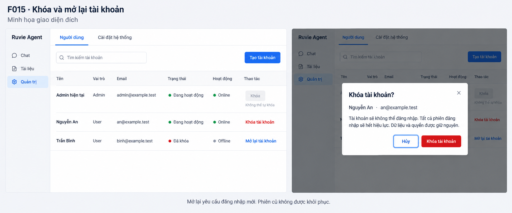

# F015 - Khóa và mở lại tài khoản

Trạng thái: F015-001 đến F015-008 đã triển khai và kiểm chứng ngày 2026-10-28.
F015-009 đã hoàn tất và nghiệm thu thông báo đăng nhập cho tài khoản bị khóa ngày 2026-10-29.
Ngày lập: 2026-10-28.

## Goal

Bổ sung chức năng để admin khóa hoặc mở lại tài khoản trong Ruvie Agent.
Khóa chặn đăng nhập và thu hồi toàn bộ session của tài khoản đích.
Mở lại cho phép đăng nhập mới. Mở lại không phục hồi session đã thu hồi.
Giữ nguyên tài khoản, quyền và dữ liệu liên quan.

### Phân biệt hiện trạng và yêu cầu

- **Code trước F015:** Có `User.is_active`, kiểm tra trạng thái khi đăng nhập và resolve session. Chưa có API hoặc UI admin thay đổi trạng thái.
- **Spec yêu cầu:** Admin thực hiện thao tác có kiểm tra quyền, bảo vệ admin cuối cùng, thu hồi session và audit nguyên tử. UI xác nhận thao tác và báo kết quả an toàn.
- **Triển khai đề xuất:** Dùng cột hiện có, service admin hiện có và một endpoint riêng cho trạng thái. Các tên mới trong tài liệu này là tên đề xuất, chưa tồn tại.

### Minh họa giao diện đích



Ảnh minh họa do AI tạo, được duyệt làm tham khảo về format và hành vi. Khi triển
khai, phải kết hợp với giao diện admin thực tế tại thời điểm code. Không coi ảnh
là bản thiết kế bắt buộc khớp từng pixel.

- Giữ shell, sidebar, navigation, bảng, search, phân trang và thao tác sửa hiện có; chỉ bổ sung trạng thái và thao tác của F015 trong bối cảnh đó.
- Dùng component, typography, spacing, token màu, theme, nút và dialog hiện có. Không dựng lại trang hoặc thay style chung theo ảnh.
- Trạng thái tài khoản và presence phải phân biệt bằng nhãn rõ ràng. Tên, email và dữ liệu trong ảnh chỉ là ví dụ, không hard-code vào ứng dụng.
- Quy tắc nghiệp vụ, API, accessibility và lifecycle trong spec có ưu tiên khi ảnh lược bỏ chi tiết. Cả khóa và mở lại đều cần xác nhận dù ảnh chỉ thể hiện dialog khóa.
- Nghiệm thu bằng giao diện thực tế và kiểm thử hành vi; không dùng so sánh pixel với ảnh để buộc thay đổi UI ngoài phạm vi.

### Baseline trước F015 đã kiểm tra

| Tệp/hàm hiện có | Hành vi hiện tại | Cách dùng trong F015 |
| --- | --- | --- |
| `backend/ruvie/models/auth.py::User`, `AuthSession` | Có `is_active`, `system_role`, session lưu token hash | Dùng lại schema; không thêm migration |
| `backend/ruvie/services/admin.py::require_admin` | Đọc lại actor với `populate_existing=True`; hỗ trợ khóa hàng | Kiểm tra actor trong transaction, sau khóa điều phối |
| `AdminAccountService.update_account` | Sửa danh tính/role/reset password; reset xóa mọi session; hạ role dùng `pg_advisory_xact_lock(0x52555649, 13)` | Dùng cùng khóa cho cập nhật tài khoản và đổi trạng thái; giữ nguyên hợp đồng cũ |
| `AdminAccountService.list_accounts` | Trả `is_active`; presence online chỉ khi tài khoản active | Giữ search/phân trang; bổ sung trạng thái rõ ràng trên UI |
| `backend/ruvie/contracts/admin.py::UpdateAccountRequest` | Không nhận `is_active`; cấm trường thừa | Giữ nguyên; trạng thái có contract riêng |
| `backend/ruvie/api/admin.py::AdminRoute`, `require_admin_write_access` | Mã lỗi an toàn, no-store, Origin và CSRF | Tái sử dụng cho endpoint PATCH mới |
| `backend/ruvie/services/auth.py::authenticate` | Khóa hàng user đến khi tạo session và commit; kiểm tra active | Dùng lại để tuần tự hóa login với khóa tài khoản |
| `AuthService.resolve_session`, `touch_presence`, `change_password` | Từ chối inactive; presence/password khóa user trước session | Giữ thứ tự user → session; kiểm thử tranh chấp trên PostgreSQL |
| `backend/ruvie/services/audit.py::AuditEventWriter.append` | Thêm/flush event trong transaction của caller | Ghi audit cùng transaction đổi trạng thái |
| `frontend/src/lib/features/admin/admin-api.ts` | Có summary allowlist, safe error, GET by ID | Thêm lời gọi trạng thái; không gửi lại PATCH tự động |
| `frontend/src/lib/features/admin/admin-state.svelte.ts::createAdminState` | Sở hữu danh sách, generation, dispose và reconcile edit | Thêm state đổi trạng thái trong feature, không đưa nghiệp vụ vào page |
| `frontend/src/lib/features/admin/AccountsPanel.svelte` | Danh sách có sửa tài khoản, polling presence 15 giây khi active | Thêm cột trạng thái và thao tác riêng; tránh chồng dialog |
| `frontend/src/lib/pages/AdminPage.svelte` | Tạo/dispose admin state; chưa nhận ID actor | Truyền ID actor từ `WorkspacePage` xuống để UX ngăn tự khóa |
| `frontend/src/lib/shared/SurfaceDialog.svelte` | Native dialog, focus trap/restore, closeDisabled | Dùng lại cho xác nhận; không viết modal infrastructure mới |

### Legacy đã kiểm tra và quyết định tái sử dụng

| Nguồn | Hành vi tham khảo | Thích nghi bắt buộc |
| --- | --- | --- |
| `references/backend/ruvie/routers/users.py::update_user_by_id` | Admin cập nhật user, bảo vệ primary admin, vô hiệu hóa socket session khi đổi role | Dùng active PostgreSQL, cookie/CSRF và `is_active`; bảo vệ admin active cuối cùng thay vì primary admin; xóa `AuthSession`, không port socket/event infrastructure |
| `references/src/lib/components/admin/Users/UserList/EditUserModal.svelte::submitHandler` | Admin chọn tài khoản, cập nhật, báo lỗi và refresh khi thành công; role có `pending` | Chỉ tham khảo hành vi; không dùng `pending` để khóa, không dùng `localStorage.token`, raw exception hoặc runtime legacy |

Ưu tiên code active. Không cần sao chép source legacy cho tính năng này.
Không đọc hoặc dùng nội dung trong bất kỳ thư mục tên `archive` nào.

## User Story

Là admin, tôi muốn khóa hoặc mở lại tài khoản nhân viên để kiểm soát quyền sử dụng
Ruvie Agent mà vẫn giữ dữ liệu và lịch sử liên quan.

Các lý do nghiệp vụ:

- Nhân viên nghỉ việc hoặc tạm ngừng công việc: chặn truy cập, giữ hội thoại, tài liệu và audit đã có.
- Tài khoản nghi bị lộ: dừng cả session đã đăng nhập. Trạng thái khóa thể hiện rõ tài khoản tạm thời không được dùng, độc lập với đổi/reset mật khẩu.
- Ruvie Agent chứa kiến thức nội bộ có phân quyền: khóa là chốt truy cập chung; admin không phải gỡ từng quyền tài liệu để chặn tài khoản.
- Khóa nhầm hoặc nhân viên quay lại: mở lại tài khoản cũ, không tạo tài khoản mới.

Giữ hội thoại nghĩa là không xóa dữ liệu hội thoại hiện có; F015 không bổ sung
lưu hội thoại bền vững. Giữ quyền không có nghĩa quyền hết hạn tự có hiệu lực lại.

## Scope

### In

- Khóa/mở tài khoản user và admin khác, chỉ bởi admin đang active.
- Chặn tự khóa; bảo vệ admin active cuối cùng khi có yêu cầu đồng thời.
- Dùng `User.is_active`; giữ nguyên role, password hash, membership, grant, provider settings và nội dung tài liệu.
- Khóa xóa toàn bộ session tài khoản đích, kể cả session hết hạn, trong cùng transaction.
- Mở lại yêu cầu đăng nhập mới; không phát cookie hoặc session cho người đích.
- Hiển thị trạng thái riêng với presence; xác nhận, pending, toast và lỗi an toàn.
- Dịch vi-VN, en-US và ru-RU; dùng token/theme và dialog hiện có.
- Kiểm thử contract, service, HTTP, tranh chấp PostgreSQL và browser/E2E.

### Out

- Xóa tài khoản, khóa tự động theo thời gian, nhập lý do khóa hoặc gửi email.
- Khôi phục admin khi toàn bộ admin đã bị khóa ngoài luồng được hỗ trợ.
- Sửa role, reset mật khẩu hoặc thay quyền tài liệu trong cùng request đổi trạng thái.
- Hủy request/stream đã được xác thực trước khi transaction khóa commit.
- Xóa cookie từ xa, xóa nội dung đã hiển thị hoặc dữ liệu đã tải trên trình duyệt khác.
- Thêm WebSocket, force logout push, polling mới hoặc cache quyền.
- Thêm schema, dependency, batch action hay audit viewer.
- Sửa các thay đổi chưa commit của F014 hoặc xử lý việc sắp xếp tài liệu không liên quan.

## Flow

### 1. Trải nghiệm admin

1. Admin mở danh sách tài khoản. Mỗi hàng có **Đang hoạt động** hoặc **Đã khóa**.
2. Trạng thái không dùng cùng ý nghĩa với Online/Last active. Không chỉ dùng màu.
3. Với tài khoản active khác mình, hiển thị nút icon người kèm dấu X trong vòng tròn cho **Khóa tài khoản**; với inactive, dùng icon người kèm dấu check trong vòng tròn cho **Mở lại tài khoản**. Nút giữ accessible name gồm thao tác và tài khoản đích; tooltip giải thích khi hover/focus.
4. Hàng của actor không cho tự khóa; dùng aria-disabled và chặn thao tác, vẫn nhận focus để hiển thị giải thích qua tooltip thay vì text cố định. Tooltip đóng khi Escape hoặc rời nút. Backend vẫn bắt buộc kiểm tra.
5. Chọn thao tác mở dialog có tên/email tài khoản và thao tác đích rõ ràng.
6. Khóa: thông báo mọi phiên sẽ hết hiệu lực, dữ liệu/quyền được giữ. Mở lại: thông báo cần đăng nhập mới và giữ quyền còn hiệu lực.
7. Có nút Hủy và nút xác nhận cụ thể. Nút xác nhận khóa có nền đỏ, chữ trắng ở cả theme sáng/tối. Focus ban đầu ở Hủy; hỗ trợ Escape và trả focus khi đóng. Không dùng `window.confirm`.
8. Chỉ sau xác nhận mới gửi PATCH. Pending khóa nút gửi để tránh lặp; hiển thị trạng thái đang xử lý. Không đồng thời mở dialog sửa/tạo và dialog trạng thái.
9. Thành công: dùng summary server, cập nhật hàng, đóng dialog, một toast thành công; refresh giữ search/page hiện tại. Khóa đặt presence hiển thị offline ngay.
10. Lỗi nghiệp vụ: một toast lỗi, giữ trạng thái đã xác minh; không đổi optimistic `is_active` trước server.
11. Lỗi mạng/response hỏng: không suy ra thất bại hay thành công. Thực hiện một GET by ID để quan sát trạng thái hiện tại. Không retry PATCH tự động.
12. Rời view, logout hoặc đổi actor: đóng dialog và vô hiệu hóa kết quả UI cũ. Request đã gửi vẫn có thể commit ở server.

### 2. Hợp đồng HTTP đề xuất

`PATCH /admin/users/{account_id}/activity`

```json
{"is_active": false}
```

- `SetAccountActivityRequest`: strict boolean bắt buộc, `extra="forbid"`, `hide_input_in_errors=True`.
- Chỉ nhận JSON boolean `true` hoặc `false`. Từ chối chuỗi, số, null, thiếu trường, JSON hỏng, mảng và trường thừa.
- Actor đến từ cookie/dependency tin cậy, không từ body. Không nhận role, user ID actor, password, grant hoặc danh sách session trong body.
- Dùng Origin allowlist trước parse body, admin dependency và CSRF hiện có.
- Thành công `200`, body `{"user": AdminAccountSummary}` theo wrapper hiện có `CreateAccountResponse`. Không trả ORM/secret, không `Set-Cookie`.
- Mọi response của endpoint có `Cache-Control: no-store`.
- `PATCH /admin/users/{id}` cũ tiếp tục từ chối `is_active`; không mở đường vòng đổi trạng thái.

| HTTP | `detail.code` | Điều kiện |
| --- | --- | --- |
| 401 | `authentication_required` | Không có session hợp lệ hoặc actor inactive |
| 403 | `admin_required` | Actor active nhưng không còn admin |
| 403 | `origin_not_allowed` / `csrf_invalid` | Origin/CSRF không hợp lệ |
| 404 | `account_not_found` | Admin hợp lệ, account_id không tồn tại |
| 409 | `last_active_admin` | Khóa sẽ làm mất admin active cuối cùng |
| 409 | `self_deactivation_forbidden` | Actor tự khóa nhưng không thuộc lỗi admin cuối cùng |
| 422 | `validation_error` | Body không đúng contract |
| 503 | `account_activity_unavailable` | Lỗi xử lý/transaction, không trả exception hoặc SQL |

Validation chỉ cần mã `validation_error` chung cho endpoint này; không bắt buộc
mở rộng allowlist trường dùng chung ở `api/security.py`. Không phản chiếu input,
key tùy ý, đường dẫn storage, cookie, token hoặc hash. Khi Origin sai và body
hỏng, trả lỗi Origin. Không thêm quy tắc ưu tiên lỗi khác ngoài luồng hiện có.
Không trả metadata tài khoản đích cho người không có quyền admin.

### 3. Use case và transaction đề xuất

`AdminAccountService.set_account_activity(actor_user_id, account_id, command)`
nhận ID actor tin cậy, ID đích và contract. Trả `AdminAccountSummary` sau commit.
Dùng lỗi miền hiện có; thêm `SelfDeactivationForbidden` cho tự khóa.

Thực hiện theo thứ tự:

1. Revalidate command tại service.
2. Trên PostgreSQL, lấy advisory transaction lock `(0x52555649, 13)` trước mọi row lock. Đây là khóa dùng chung với sửa tài khoản.
3. Đọc lại actor qua `require_admin(..., lock=True)` sau khi lấy advisory lock.
4. SELECT FOR UPDATE user đích với `populate_existing=True` để bỏ dữ liệu cũ trong identity map. Nếu thiếu, trả lỗi miền.
5. Với yêu cầu khóa admin active, đếm admin `system_role='admin' AND is_active=true`. Nếu chỉ còn một, trả `last_active_admin` trước kiểm tra tự khóa.
6. Nếu yêu cầu khóa actor, trả `self_deactivation_forbidden`.
7. Nếu trạng thái đã bằng yêu cầu: trả summary sau commit, không ghi event thay đổi mới. Với `false`, vẫn xóa session còn sót để duy trì trạng thái khóa.
8. Nếu đổi sang `false`: set `is_active=False`, xóa mọi `AuthSession` có `user_id` đích. Nếu đổi sang `true`: set `is_active=True`; không tạo session.
9. Flush; append audit; snapshot summary trước commit làm expire ORM. Commit đúng một lần. Bất kỳ lỗi nào đều rollback.

**Khóa dùng chung:** mở rộng `update_account` để lấy advisory lock hiện có cho
mọi request cập nhật hợp lệ, trước `require_admin(lock=True)`, thay vì chỉ hạ role.
Cách này tuần tự hóa thao tác admin có actor/target row lock, tránh hai admin
khóa chéo hoặc cập nhật chéo giữ hai hàng theo thứ tự ngược nhau. Có thể tách
private helper nhỏ trong `services/admin.py`; không thêm service/layer mới.
Không đặt khóa toàn cục vào login, retrieval hoặc mọi request đọc.

Mọi luồng hạ role cũ và đổi trạng thái mới phải dùng cùng key. Không tạo key F015
riêng. Giữ hành vi tự hạ role của F013: được phép khi còn admin active khác và
session hiện tại còn hiệu lực. F015 không thay luật này.

**Phạm vi bảo đảm:** sau khi transaction khóa commit, request mới xác thực bằng
session cũ bị từ chối. Login giữ row lock trước khi tạo session: nếu login thắng,
khóa tài khoản sẽ xóa session vừa tạo; nếu khóa thắng, login phải đọc trạng thái
inactive rồi từ chối. Mở lại không làm token cũ có hiệu lực vì các session đã xóa.
Không hứa hủy request đã vượt bước xác thực trước commit.

### 4. Audit và bảo toàn dữ liệu

| Chuyển trạng thái thực tế | action | outcome | reason |
| --- | --- | --- | --- |
| true → false | `account.deactivate` | `allow` | `deactivated_and_sessions_revoked` |
| false → true | `account.activate` | `allow` | `reactivated` |

Dùng `resource_type='user'`, resource_id đích và actor_user_id người thực hiện.
Chỉ audit thành công khi trạng thái thực sự đổi. Không thêm event cho no-op hoặc
error trong F015; không thay chính sách audit denial toàn hệ thống. Không ghi
email/password/session secret vào reason. Audit lỗi phải rollback cả trạng thái
và xóa session. Event cũ không được sửa/xóa.

Chỉ `is_active`, timestamp tự cập nhật hiện có và session đích được thay đổi.
Không xóa user; không sửa password hash, role, membership, grant, tài liệu,
revision/chunk, provider settings hoặc dữ liệu hội thoại hiện có. Khi mở lại,
quyền vẫn phải qua predicate DB hiện tại và thời hạn grant hiện tại.

### 5. State frontend và kết quả không chắc chắn

- Thêm `setAccountActivity(id, isActive, csrfToken)` trong `admin-api.ts`. Encode ID, gửi cookie/CSRF và strict boolean; parse bằng summary allowlist.
- Bổ sung `self_deactivation_forbidden`, `account_activity_unavailable` vào safe codes. Không đưa body lỗi thô lên UI.
- `createAdminState` thêm `activityBusy`, `activityError` và `changeActivity(user, desired)`; dùng bộ đếm operation riêng. Chỉ cho một mutation edit/activity đang chạy trên owner. Không cản người dùng điều hướng.
- Kết quả đề xuất: `{status: 'updated'|'observed'|'rejected'|'uncertain'|'ignored', user?: AccountSummary}`. `updated` chỉ cho response PATCH hợp lệ khớp ID và desired state.
- GET reconcile chỉ chứng minh trạng thái hiện tại; dùng `observed`, không nói PATCH của mình đã thành công. UI cập nhật dữ liệu và toast trung tính “Trạng thái hiện tại đã được cập nhật”.
- Khi GET không thành công: `uncertain`, toast “Chưa xác định được kết quả. Hãy tải lại trạng thái trước khi thao tác tiếp.” Chặn thao tác mới trên tài khoản đó đến khi GET/list refresh xác minh lại. Không retry mutation ngầm.
- 401 gọi onexpired; 403 `admin_required` gọi onforbidden. Origin/CSRF chỉ báo lỗi, không giả định mất session.
- Sau mutation, vô hiệu hóa list request đã bắt đầu trước mutation; refresh mới giữ query/page. Background polling không được ghi đè summary bằng dữ liệu cũ.
- Khi owner dispose, bỏ mọi apply/callback từ response cũ. Khi panel không active, hủy UI operation generation và toast/dialog của feature; không tuyên bố abort browser hủy transaction server.
- Truyền `actorUserId` từ `WorkspacePage` → `AdminPage` → `AccountsPanel`. Đây chỉ để disable tự khóa; API vẫn là nơi quyết định quyền.
- Toast do component feature sở hữu; có ID và cleanup. Không thêm Toaster toàn cục. Một kết quả có tối đa một toast; không phát toast cho polling bình thường.

## Edge Cases

| Trường hợp | Kết quả yêu cầu |
| --- | --- |
| Khóa/mở lặp cùng trạng thái | 200 summary; không tạo audit thay đổi trùng |
| Admin tự khóa, có admin khác | 409 self_deactivation_forbidden; không đổi gì |
| Admin active cuối cùng tự khóa | 409 last_active_admin; không đổi gì |
| Có admin inactive khác | Không tính vào số admin active |
| Hai admin khóa chéo | Một thành công; bên còn lại bị từ chối sau khi đọc lại actor; còn admin active |
| Khóa chạy đồng thời với hạ role admin | Dùng cùng advisory lock; không mất admin active cuối cùng |
| Khóa và mở cùng target | Tuần tự theo khóa DB; summary phản ánh thứ tự commit, không cam kết last-click-wins |
| Login/presence/password change tranh chấp với khóa | Tuân thủ user → session; không còn session hợp lệ sau khóa commit |
| Audit hoặc commit lỗi | Rollback trạng thái và session, không success event |
| Target đã bị xóa ngoài luồng được hỗ trợ | 404; refresh danh sách, không dùng email để chọn target khác |
| Actor bị hạ role/khóa trong lúc chờ | Kiểm tra DB sau khóa; từ chối mutation |
| Trình duyệt target đang mở | Request bảo vệ tiếp theo bị từ chối; dùng cơ chế hết phiên/presence hiện có, không push mới |
| Khóa rồi mở lại | Cookie cũ vẫn vô hiệu; login mới cần password hiện tại |
| Admin reset password khi tài khoản khóa | Không tự mở lại; giữ contract reset hiện có |
| Thay locale/theme, tên/email dài | Label/toast dịch đúng; dialog đọc được, keyboard/zoom dùng được |

## Acceptance Criteria

- [x] AC-01: Chỉ admin active có session, Origin và CSRF hợp lệ được đổi trạng thái qua API.
- [x] AC-02: Strict body boolean, no-store cho mọi response; không phản chiếu input/secret và không Set-Cookie khi thành công.
- [x] AC-03: Khóa user/admin khác đổi is_active=false và xóa toàn bộ session đích trong một transaction.
- [x] AC-04: Sau khóa commit, login đúng password và request mới bằng mọi cookie cũ đều bị từ chối; tài khoản khác còn dùng được.
- [x] AC-05: Mở lại giữ cùng ID/password/role/quyền/dữ liệu; không tạo hoặc phục hồi session. Cookie cũ vẫn 401; login mới thành công.
- [x] AC-06: Không tự khóa; không mất admin active cuối cùng; inactive admin không được tính. Giữ hành vi tự hạ role F013.
- [x] AC-07: Tranh chấp khóa chéo, khóa/hạ role, login/khóa và actor mất quyền được chứng minh trên PostgreSQL, không deadlock trong test có timeout.
- [x] AC-08: Audit allow đúng actor/target/action, nguyên tử; no-op không thêm event thay đổi; failure rollback cả session và trạng thái.
- [x] AC-09: UI có trạng thái tài khoản tách presence, nút đúng trạng thái, ngăn tự khóa và xác nhận rõ tài khoản đích trước request.
- [x] AC-10: Pending chống gửi lặp; state danh sách/presence không bị response cũ ghi đè; không optimistic state sai.
- [x] AC-11: Lỗi HTTP/mạng/response hỏng an toàn; reconcile không nhận công trạng mutation; không tự retry PATCH; 401/403 xử lý đúng owner.
- [x] AC-12: Rời view/logout/đổi actor không có dialog/toast/callback muộn; dùng được keyboard, focus, zoom và hai theme, ba locale.
- [x] AC-13: Không sửa dữ liệu ngoài phạm vi; không migration/dependency mới; không port role pending hoặc runtime legacy.
- [x] AC-14: Required backend/frontend/browser checks đạt; báo số pass/fail/skip thực tế. Skip hoặc failure chưa giải quyết không được tick nghiệm thu đầy đủ.

Các tiêu chí bổ sung dưới đây thuộc F015-009. Kết quả nghiệm thu 001–008 không chứng minh các tiêu chí này đã đạt.

- [x] AC-15: Tài khoản bị khóa và mật khẩu đúng nhận HTTP 403 với `detail.code=account_disabled`; không tạo session hoặc Set-Cookie, response có no-store.
- [x] AC-16: Sai mật khẩu, email không tồn tại hoặc tài khoản không có password hash vẫn nhận lỗi credentials chung. Chỉ mật khẩu đúng mới làm lộ trạng thái khóa; quy tắc này không cam kết thời gian phản hồi bằng nhau.
- [x] AC-17: Frontend chỉ dùng thông báo tài khoản bị khóa cho đúng cặp HTTP 403/account_disabled. 401 vẫn báo sai thông tin đăng nhập; 403 khác hoặc body hỏng dùng lỗi chung an toàn, không hiển thị raw body.
- [x] AC-18: Login hiển thị đúng một toast lỗi đã dịch ở vi-VN/en-US/ru-RU; giữ form đăng nhập, không mở workspace và không tự gửi lại request. Mở lại tài khoản cho phép đăng nhập mới; session cũ vẫn 401.
- [x] AC-19: Hai test PostgreSQL bị ảnh hưởng được cập nhật theo contract mới và vẫn chứng minh chờ khóa thật. Full backend, frontend và browser liên quan đạt; báo pass/fail/skip mới, không dùng số liệu cũ để tick task.

## Tasks

Thực thi theo thứ tự 001 → 008. Mỗi lượt chỉ thực hiện task được yêu cầu.
Đọc spec và caller trước khi code; báo phạm vi tệp và xin duyệt theo AGENTS.md.
Duyệt spec không tự cho phép sửa production/test/config. Những đường dẫn mới bên
dưới là đề xuất. Không tick task chỉ vì đã viết test hoặc code mà chưa kiểm chứng.

### F015-001 — Contract trạng thái và kiểm thử validation

- [x] Hoàn thành F015-001.

**Where:** Sửa `backend/ruvie/contracts/admin.py`. Tạo `tests/test_f015_001_activity_contract.py`.

**Work:**

1. Đọc CreateAccountResponse, AdminAccountSummary, UpdateAccountRequest.
2. Viết test contract cho true/false; từ chối thiếu, null, string, number, array và extra fields. Kiểm tra request không chứa field actor/role/password được chấp nhận.
3. Thêm `SetAccountActivityRequest` đúng phần HTTP; không thêm is_active vào UpdateAccountRequest.
4. Kiểm tra summary/response cũ đã có is_active, không tạo duplicate response type hoặc schema mới.

**Done:** Test contract đạt; contract update cũ vẫn từ chối is_active. Chưa tuyên bố endpoint hoặc feature hoàn tất. AC-02, AC-13 có coverage tầng contract.

### F015-002 — Service, khóa chung và audit nguyên tử

- [x] Hoàn thành F015-002.

**Where:** Sửa `backend/ruvie/services/admin.py`. Tạo `tests/test_f015_002_activity_service.py`. Dùng `services/audit.py`, `models/auth.py` hiện có; không sửa schema.

**Work:**

1. Viết test service với actor admin, target user/admin, nhiều session đích và session tài khoản khác.
2. Thêm lỗi miền tự khóa và use case set_account_activity theo đúng thứ tự transaction đã chốt.
3. Đưa advisory lock của update_account về trước actor lock cho mọi update hợp lệ. Dùng cùng key với activity. Chỉ giữ guard PostgreSQL như hiện tại; SQLite không chứng minh concurrency.
4. Refresh target với populate_existing; test preload actor/target rồi thay DB bằng session khác để phát hiện authorization/state cũ.
5. Kiểm tra admin cuối cùng trước self-lock; inactive không tính. Revalidate command ở service.
6. Thêm audit transition; no-op không audit. false no-op xóa session tồn dư nếu có. Không commit trong audit helper.
7. Inject lỗi sau session delete và khi audit/commit trước commit thật; đọc bằng DB session mới để chứng minh rollback. Không giả lập lỗi sau commit rồi đòi DB rollback.
8. Snapshot role/hash/grants/membership/provider/tài liệu liên quan trước/sau; chỉ cho phép thay state/timestamp/session đích.

**Done:** Service test đạt; có bằng chứng rollback, no-op, data preservation và actor mất quyền. Chạy regression admin role/password hiện có. AC-03, AC-05, AC-06, AC-08, AC-13 có coverage service.

### F015-003 — Endpoint bảo vệ và lỗi an toàn

- [x] Hoàn thành F015-003.

**Where:** Sửa `backend/ruvie/api/admin.py`. Tạo `tests/test_f015_003_activity_api.py`. Reuse dependencies/security hiện có.

**Work:**

1. Viết HTTP test cookie thực qua /auth/login như test_f013_008_admin_roles.py. Không override admin dependency cho test permission chính.
2. Thêm route PATCH /users/{account_id}/activity trong router /admin; gọi service, bọc summary bằng CreateAccountResponse.
3. Map SelfDeactivationForbidden → 409 và lỗi bất ngờ của route mới → 503 account_activity_unavailable. Không đổi mã lỗi generic của PATCH update cũ.
4. Dùng AdminRoute để no-store cả success/failure; xác minh Origin được kiểm tra trước parse, CSRF đúng session và actor DB.
5. Test 200/401/403/404/409/422/503, body xấu, extra fields, actor user/inactive/demoted, CSRF thiếu/sai và Origin sai + JSON hỏng.
6. Assert không Set-Cookie khi success, không secret/SQL/raw input ở response. PATCH update cũ nhận is_active vẫn 422.
7. Test khóa → session cũ 401/login fail → mở → cookie cũ 401/login mới 200. Target là user và admin khác; actor không mất session.

**Done:** HTTP contract đúng bảng mã lỗi; regression admin create/list/update/reset và auth vẫn đạt. AC-01 đến AC-06, AC-08 có bằng chứng HTTP.

### F015-004 — Chứng minh tranh chấp bằng PostgreSQL

- [x] Hoàn thành F015-004.

**Where:** Tạo `tests/test_f015_004_activity_concurrency.py`. Reuse disposable fixture `tests/test_f005_007_e2e.py`; tham khảo `test_f013_008_admin_roles.py`, `test_f014_004_password_concurrency.py`.

**Work:**

1. Dùng DB session/connection riêng cho từng thread. Event/barrier điều khiển thứ tự; dùng timeout và cleanup trong finally. Không dựa vào sleep dài hoặc chạy race lặp để cầu may.
2. Hai admin A/B khóa chéo: đúng một mutation thành công; bên chờ bị AuthenticationRequired sau refresh; còn đúng một admin active.
3. A khóa B đồng thời B tự hạ role, và A tự hạ role đồng thời B khóa A: thử thứ tự giành khóa có ý nghĩa; luôn còn ít nhất một admin active, không stale actor ghi thành công.
4. Giữ advisory lock bằng connection riêng, bắt đầu mutation rồi thay role/activity actor trước khi nhả lock. Mutation phải đọc lại và từ chối.
5. Login target trước khóa: session tạo ra bị khóa xóa. Khóa trước login: login từ chối. Chứng minh đường authenticate → create_session thật giữ user lock.
6. Tranh chấp với presence và tự đổi password: không hồi sinh session sau khóa commit. Chạy các thứ tự quyết định trạng thái cuối; không giả định request đã xác thực luôn bị hủy.
7. Hai lệnh khóa cùng target: một transition audit, mọi session đích mất. Khóa/mở: kết quả theo thứ tự commit; token cũ không sống lại.
8. Kiểm tra DB bằng session mới: số admin active, activity đích, session và audit; test timeout phải fail và giải phóng worker/transaction.

**Done:** PostgreSQL concurrency suite đạt thật, không skip. Không dùng SQLite để tick AC-07. Không chạy hai backend suite đồng thời.

### F015-005 — API client và state đổi trạng thái

- [x] Hoàn thành F015-005.

**Where:** Sửa `frontend/src/lib/features/admin/admin-api.ts`, `admin-state.svelte.ts`, `frontend/tests/admin-api.test.mjs`, `frontend/tests/admin-state.test.mjs`.

**Work:**

1. Viết test payload boolean chính xác, URL encode ID, CSRF/cookie/cache, parse summary và safe codes mới.
2. Thêm setAccountActivity; không đưa activity vào updateAccount hoặc submit edit form.
3. Thêm changeActivity và state đúng phần Flow 5. Guard edit/activity dùng chung; giữ create/saveUser behavior hiện có.
4. Validate response ID/is_active khớp request. Sai/mất response đi một GET reconcile. Test observed khác updated; GET thất bại → uncertain và khóa thao tác trên target tới refresh thành công.
5. Invalidate list generation trước apply/refetch để request cũ không ghi đè. Giữ query/page và cập nhật offline khi khóa; không xóa user khỏi danh sách.
6. Test dispose trong PATCH lẫn GET, 401, admin_required, CSRF, response đảo thứ tự và polling đang chạy. Không apply hoặc gọi callback sau dispose.
7. Cung cấp phương thức invalidate operation UI khi rời view nếu cần; không reset identity hoặc tạo global event bus mới.

**Done:** API/state tests đạt; PATCH không tự retry; không ảnh hưởng reset password/role. AC-10, AC-11 và lifecycle của AC-12 có coverage.

### F015-006 — UI xác nhận, trạng thái và bản dịch

- [x] Hoàn thành F015-006.

**Where:** Sửa `frontend/src/lib/features/admin/AccountsPanel.svelte`, `frontend/src/lib/pages/AdminPage.svelte`, `frontend/src/lib/pages/WorkspacePage.svelte`, ba catalog `frontend/src/lib/i18n/locales/{vi-VN,en-US,ru-RU}/translation.json`. Dùng SurfaceDialog; chưa cần tạo component dialog riêng.

**Work:**

1. Đọc mục Minh họa giao diện đích và kiểm tra giao diện admin hiện có; dùng ảnh để hiểu hành vi, kết hợp với bối cảnh UI thực tế. Truyền actorUserId qua page composition; không fetch identity riêng trong AccountsPanel và không lấy actor từ row đang chọn.
2. Thêm cột trạng thái bằng text; giữ presence/last active riêng. Nút dùng icon người kèm dấu X/check trong vòng tròn và có accessible name chứa thao tác và tài khoản đích.
3. Thêm dialog xác nhận cho cả khóa và mở. Bind target ID + desired state khi mở; không tự đảo desired theo polling. Nếu refresh cho biết state đã đổi, yêu cầu xem lại trước confirm thay vì đổi ý nghĩa nút.
4. Ngăn tự khóa ở UI bằng aria-disabled và guard thao tác; giữ focus để đọc giải thích trong tooltip khi hover/focus, đóng bằng Escape hoặc rời nút. Không đoán số admin toàn hệ thống từ một trang danh sách để quyết định quyền; server trả last_active_admin.
5. Dùng SurfaceDialog focus Hủy, Escape/Tab/restore; pending chống double click/Enter. Đóng và invalidate UI khi active=false; chỉ một dialog tạo/sửa/trạng thái mở.
6. Nối changeActivity với một toast success/error/neutral tương ứng result. Dismiss toast feature khi rời view; response cũ không tạo toast lên view/actor mới.
7. Dịch mọi nội dung, gồm lỗi mới và trạng thái chưa xác định. Giữ key tương đương ba catalog; dùng token hiện có, không bọc trang bằng card mới.
8. Build/lint/format check và frontend unit tests theo README/AGENTS. Không đổi EditUserModal chỉ để gộp status vào form.

**Done:** UI đúng Flow 1 và state machine; keyboard/theme/locale được browser task 007 xác minh. AC-09 đến AC-12 có đường thực thi rõ.

### F015-007 — Browser giả HTTP, E2E thật và regression

- [x] Hoàn thành F015-007.

**Where:** Tạo `frontend/tests/admin-activity-browser.mjs`, `frontend/tests/admin-activity-e2e.mjs`, `tests/test_f015_007_activity_e2e.py`. Chỉ mở rộng test hiện có nếu cần coverage liên quan; không sửa assert để che regression.

**Work:**

1. Đọc prerequisite build/Playwright/Chromium trong README/AGENTS; báo và xin duyệt phạm vi sinh dist/log trước chạy. Docker Desktop Linux containers cho DB tests.
2. Fake HTTP script theo admin-browser.mjs: xác nhận/cancel, self disable, status/presence, pending double submit, mỗi mã lỗi, response mất/hỏng, reconcile observed/uncertain và refresh cũ đến muộn.
3. Trì hoãn response rồi rời view/logout/đổi actor; không toast/callback cũ, không PATCH thứ hai. Kiểm tra search/page và polling sau đổi trạng thái.
4. Kiểm tra vi/en/ru, light/dark, keyboard focus/Tab/Escape và browser zoom; desktop là target hiện tại, không thêm mobile layout feature.
5. Python wrapper dùng fixture disposable backend/DB và script E2E như test_f014_007_password_e2e.py. Không chạy script trực tiếp vào database ứng dụng.
6. Tạo admin A và target T với hai context T1/T2; thêm tài khoản U không liên quan. Login thật, khóa T qua UI A, xác minh T1/T2 bị 401 và login T bị từ chối; A/U vẫn dùng được.
7. Mở T qua UI A, chứng minh token T1/T2 cũ vẫn 401; context mới đăng nhập password hiện tại thành công. Lặp ca target admin khác.
8. Snapshot DB trước/sau: ID, hash, role, membership/grant, dữ liệu liên quan, session, audit. Bảo toàn dữ liệu và đúng một event mỗi transition. Không cần tạo hệ thống lưu hội thoại để test.
9. Chạy full backend suite, frontend test/build/lint/format:check và các browser regression trong AGENTS; thêm admin-activity-browser và account-settings-browser của F014. Chạy backend tuần tự.
10. Ghi lệnh thực tế, pass/fail/skip, prerequisite và lỗi còn lại. Không dùng provider thật; không commit generated dist/log/screenshot.

**Done:** AC-01 đến AC-14 có bằng chứng đúng tầng; full backend/frontend/browser bắt buộc đạt. Skip không là pass; blocker giữ task unchecked. Focused test không thay full suite.

### F015-008 — Đồng bộ tài liệu và bàn giao

- [x] Hoàn thành F015-008.

**Where:** Sửa `specs/02-architecture.md`, `specs/to-be/admin-roadmap.md`, spec F015 này. Chỉ bắt đầu sau khi task 007 có bằng chứng đạt.

**Work:**

1. Đọc diff implementation cuối cùng; cập nhật hiện trạng API/service, session revocation, shared lock, audit và UI. Không ghi thiết kế chưa code là đã có.
2. Chuyển riêng mục khóa/mở trong roadmap thành đã có và link F015; giữ toàn bộ backlog khác.
3. Ghi kết quả kiểm chứng, ngày, command và pass/fail/skip thực tế trong F015; tick từng task/AC đủ bằng chứng. Không tick nhiệm vụ ngoài F015.
4. Kiểm tra link/path, task ID duy nhất, no migration và giới hạn request đang chạy. Không thêm bản sao lệnh vận hành trong spec.
5. Chạy diff whitespace check; xác nhận không sửa archive/references, không có secret/generated output và không ghi đè thay đổi F014 hiện có.
6. Bàn giao theo skill: mỗi production/config file đã đổi, hàm chính/input/output, tái sử dụng active/legacy, kết quả test và giới hạn còn lại. Không tự commit nếu chưa được yêu cầu.

**Done:** Tài liệu khớp code đã kiểm chứng; không mất backlog hoặc thổi phồng mức hoàn tất.

### F015-009 — Hoàn thiện thông báo đăng nhập cho tài khoản bị khóa

- [x] Hoàn thành F015-009.

**User story:** Là nhân viên có tài khoản đã bị admin khóa, tôi muốn biết tài khoản
đang bị khóa khi nhập đúng thông tin đăng nhập, để liên hệ admin thay vì liên tục
thử lại mật khẩu. Người nhập sai mật khẩu chỉ nhận lỗi credentials chung.

**Baseline trước nghiệm thu F015-009:**

- `backend/ruvie/services/auth.py::AccountDisabledError` và nhánh xử lý trong `AuthService.authenticate` đã có trong working tree do lượt làm trước. Password được kiểm tra trước khi raise cho tài khoản inactive.
- `backend/ruvie/api/auth.py::login` đã bắt exception và trả 403/account_disabled trước khi gọi create_session.
- `frontend/src/lib/features/auth/auth-api.ts::login` đã ánh xạ mã lỗi sang `auth.errors.accountDisabled`. Ba catalog đã có key này.
- Chưa tìm thấy test riêng cho account_disabled trong backend hoặc frontend. Đây là code nháp chưa nghiệm thu; cần giữ và kiểm chứng, không viết lại mặc định.
- `test_login_and_lock_are_serialized_on_target_row` trong `tests/test_f015_004_activity_concurrency.py` vẫn assert authenticate trả None sau khóa. `test_lock_before_login_rejects_login_after_waiting` cũng vẫn kỳ vọng future trả None. Cả hai kỳ vọng không còn khớp exception mới; chưa coi là lỗi production khi chỉ test cũ sai contract.
- Nhánh `references/backend/ruvie/routers/auths.py::signin` đã được đối chiếu: xác thực rồi tạo session hoặc trả lỗi credentials chung. Không có contract tương đương cần port. Dùng active service, cookie và PostgreSQL; không port role pending, JWT hoặc trusted-header auth.

**Where — phạm vi triển khai dự kiến:**

| Tệp | Thao tác và trách nhiệm |
| --- | --- |
| `backend/ruvie/services/auth.py` | Giữ/hoàn thiện AccountDisabledError và authenticate; chỉ sửa production nếu kiểm thử chứng minh còn thiếu |
| `backend/ruvie/api/auth.py` | Giữ/hoàn thiện ánh xạ 403/account_disabled trong login, no-store và đường lỗi không tạo session |
| `frontend/src/lib/features/auth/auth-api.ts` | Giữ/hoàn thiện parse lỗi login và fallback an toàn |
| `frontend/src/lib/i18n/locales/{vi-VN,en-US,ru-RU}/translation.json` | Kiểm tra key/thông báo đã có; chỉ chỉnh khi chưa khớp hành vi |
| `tests/test_f015_009_disabled_login.py` | Tạo test service và HTTP riêng cho thông báo khóa |
| `tests/test_f005_003_auth.py` | Cập nhật test auth cũ theo exception mới; tệp bổ sung đã được người dùng duyệt |
| `tests/test_f015_004_activity_concurrency.py` | Sửa đúng hai kỳ vọng None bị ảnh hưởng; giữ event, lock observation, timeout, cleanup và kiểm tra session |
| `frontend/tests/auth-api.test.mjs` | Thêm test ánh xạ đúng cặp status/code và fallback |
| `frontend/tests/auth-browser.mjs` | Mở rộng HTTP giả cho toast đăng nhập bị khóa ở ba locale |
| `frontend/tests/admin-activity-e2e.mjs` | Bổ sung login bị khóa vào luồng khóa/mở thật; reuse Python wrapper `tests/test_f015_007_activity_e2e.py` |
| `specs/02-architecture.md`, spec F015 này | Đồng bộ contract đăng nhập và kết quả nghiệm thu sau khi test đạt |

Không cần sửa `App.svelte`, auth toast owner, schema hoặc thêm dependency theo
thiết kế này. Nếu phát hiện cần thay ownership hoặc mở thêm tệp, báo scope mới
trước khi sửa theo AGENTS.md. Yêu cầu viết task này chỉ cho phép sửa spec.

**Hợp đồng yêu cầu:**

| Trạng thái tài khoản và password | Service | POST /auth/login | Kết quả frontend |
| --- | --- | --- | --- |
| Active, password đúng | Trả User | 200 + session theo contract cũ | Vào workspace |
| Inactive, password đúng | Raise AccountDisabledError | 403, `{"detail":{"code":"account_disabled"}}` | Toast tài khoản bị khóa |
| Active/inactive, password sai | Trả None | 401 credentials chung hiện có | Toast sai email hoặc mật khẩu |
| Email không có hoặc hash thiếu | Trả None | 401 credentials chung hiện có | Toast sai email hoặc mật khẩu |

Thông báo thống nhất: vi-VN “Tài khoản này đã bị vô hiệu hóa.”; en-US “This account
has been disabled.”; ru-RU “Эта учётная запись отключена.”. Đây là key login riêng,
không dùng để đổi thông báo hết phiên hoặc thay contract GET /auth/session.
Mở lại giữ password hiện tại; cookie cũ vẫn không có hiệu lực.

**Work — thực hiện theo thứ tự:**

1. Đọc README, AGENTS, diff sáu tệp Claude đã sửa và caller của authenticate. Giữ user work. Báo phạm vi production/test/docs và dist/log trước khi xin duyệt triển khai; không sửa code chỉ vì task đã có trong spec.
2. Viết test service/HTTP trong test_f015_009_disabled_login.py. Dùng password hash thật và DB tạm/bộ nhớ cho test đơn giản. Đọc mẫu test_f005_003_auth.py nhưng không override authenticate hoặc dependency quyền ở ca HTTP chính. Test code nháp hiện có có thể đã pass; không xóa code để tạo RED giả. Với hành vi thiếu, viết test thất bại trước khi bổ sung fix.
3. Ma trận service: active đúng/sai; inactive đúng/sai; email thiếu; hash thiếu. Với inactive đúng phải raise đúng lớp; trường hợp còn lại thất bại phải trả None. Kiểm tra số session trước/sau, hash/role/activity không đổi sau thất bại.
4. Ma trận HTTP: dùng cookie boundary thật. Inactive + đúng password phải 403/account_disabled, no-store, không Set-Cookie hoặc session mới. Inactive + sai password và email không tồn tại phải cùng 401 contract chung. Origin sai vẫn bị chặn trước xác thực; không phản chiếu password/hash/token/email tùy ý trong lỗi. Không đổi 401 của cookie đã bị thu hồi trên GET /auth/session.
5. Rà authenticate: giữ SELECT FOR UPDATE và transaction tồn tại đến create_session commit. Không trả disabled trước verify_password. Rà route: chỉ bắt AccountDisabledError cho login, không nuốt lỗi DB thành account_disabled hoặc gọi create_session ở nhánh lỗi. Không đổi các API admin, reset hay tự đổi mật khẩu.
6. Cập nhật đúng hai test cạnh tranh nêu trên để bắt AccountDisabledError: ở ca thứ nhất assertRaises quanh authenticate sau khóa; ở ca thứ hai assertRaises quanh future.result khi login chờ khóa. Không bắt mọi Exception. Giữ kiểm tra PostgreSQL thật đang chờ lock, user → session, không session sống lại và release trong finally. Chạy lại cả file concurrency.
7. Thêm auth-api.test.mjs: 403/account_disabled tạo AuthApiError đúng key/status/code; 401 vẫn credentials; 403 mã khác, thiếu detail, JSON hỏng hoặc lỗi mạng dùng fallback hiện có. 200 hợp lệ vẫn parse session; không tự retry POST. Test 401 kèm body giả account_disabled không được hiển thị thông báo khóa. Không serialize raw body. Chỉ parse body một lần trên mỗi đường thực thi; readSession hiện kiểm tra non-ok trước khi đọc body, nên không cần refactor nếu fallback đã an toàn.
8. Mở rộng mock /auth/login trong auth-browser.mjs để cấu hình được status và code. Test một submit nhận một toast đúng ba locale, vẫn ở login và không có workspace. Không lộ raw server detail; nút pending được mở lại, người dùng được sửa thông tin rồi thử lại có chủ ý. Không mở rộng layout hoặc thêm toast owner.
9. Bổ sung E2E thật vào admin-activity-e2e.mjs: sau admin khóa T, dùng context chưa đăng nhập thử đúng password nhận 403/account_disabled và sai password nhận 401; không có session mới. Sau mở, login mới 200; cookie T1/T2 cũ vẫn 401. Giữ các kiểm tra admin/U, hash, role và dữ liệu hiện có. Không mock login/session/DB ở E2E này. Chỉ chạy qua Python wrapper dùng backend/database tạm, không chạy script vào database ứng dụng.
10. Chạy focused auth/F015 trước. Sau đó chạy full backend suite theo README/AGENTS, frontend tests/build/lint/format:check, auth browser, admin browser và admin-activity-browser. Cấu hình Docker Linux, Playwright và Chromium/Edge; không chạy hai backend suite cùng lúc. Skip phải ghi là chưa xác minh. Không dùng provider thật hoặc đổi database ứng dụng.
11. Khi mọi kiểm tra đạt, cập nhật mô tả login trong specs/02-architecture.md và kết quả 009 trong spec này bằng lệnh đã chạy, pass/fail/skip thực tế. Giữ kết quả 001–008 như bằng chứng lịch sử; không sửa số liệu cũ thành kết quả cho contract mới. Tick task 009 và AC-15 đến AC-19 chỉ sau nghiệm thu. Không tự commit.

**Done:** Service, HTTP, toast và PostgreSQL concurrency đều có bằng chứng theo
contract mới. Tài khoản khóa không được tạo session; sai password không được lộ
trạng thái khóa. AC-15 đến AC-19 đạt và required regression không có failure/skip
chưa giải quyết. Nếu còn blocker, giữ checkbox mở và ghi rõ phần chưa kiểm chứng.

### Ma trận truy vết

| AC | Task chính | Bằng chứng |
| --- | --- | --- |
| 01, 02 | 001, 003, 007 | Contract/HTTP security, safe serialization |
| 03, 04, 05 | 002, 003, 004, 007 | Session DB, cookie cũ, login mới, dữ liệu giữ nguyên |
| 06, 07 | 002, 004 | Admin cuối cùng và controlled PostgreSQL concurrency |
| 08 | 002, 003, 004 | Audit transition/no-op/rollback |
| 09 | 006, 007 | Danh sách và dialog thật |
| 10, 11 | 005, 007 | Mutation/reconcile, stale list và HTTP giả |
| 12 | 005, 006, 007 | Lifecycle, locale, theme, keyboard |
| 13 | 001, 002, 008 | Diff/schema/data preservation |
| 14 | 007, 008 | Full suite và báo cáo bằng chứng |
| 15, 16 | 009 | Ma trận service/HTTP, Origin và kiểm tra không tạo session |
| 17, 18 | 009 | Auth API client, toast ba locale và E2E khóa/mở |
| 19 | 009 | PostgreSQL concurrency và lượt regression mới |

### Kết quả kiểm chứng triển khai

Nghiệm thu 2026-10-28 dùng PostgreSQL/pgvector tạm, fake providers, Playwright và Edge headless. Không sử dụng database ứng dụng.

Các kết quả dưới đây thuộc F015-001 đến F015-008, trước thay đổi account_disabled.
Kết quả riêng của F015-009 được ghi sau bảng lịch sử.

| Kiểm tra | Kết quả quan sát |
| --- | --- |
| Backend đầy đủ, bao gồm browser/E2E | 333 test đạt, 0 failure/error, 0 skip; 678,490 giây. Lượt này chạy trước các test F015 bổ sung và trước điều chỉnh frontend cuối. |
| F015 contract, service, HTTP và E2E với build cuối | 23 test đạt, 0 fail/error, 0 skip. E2E chạy cho target user và admin; giữ document, cấu hình LLM, membership và grant mẫu. |
| F015 PostgreSQL concurrency | 9 test đạt, 0 fail/error, 0 skip; kiểm tra chờ khóa thực tế, login, đổi mật khẩu, presence, quyền actor, khóa trùng và khóa/mở. |
| Frontend suite với Playwright | 97 pass, 0 fail, 0 skip. |
| Frontend build, lint và format:check | Đạt. |
| Browser F015 với HTTP giả | 41 kiểm tra đạt, gồm lỗi, đối soát, pending, đổi view/danh tính, ba locale, theme tối và visual viewport 125% bằng bàn phím. |
| Browser regression | Admin 34 nhóm; auth 61, theme 9, workspace 29, LLM 82, frontend UX 42 và F014 settings 17 kiểm tra đạt. Admin chạy lại sau thay đổi dialog cuối. |

Đã dùng cookie/session thật và database tạm trong E2E; cookie cũ của hai phiên
bị từ chối sau cả khóa và mở lại, tài khoản khác và admin vẫn hoạt động. Test
đồng thời dùng các connection riêng, đồng bộ bằng event và kiểm tra PostgreSQL
đang chờ lock; SQLite không được dùng để chứng minh cạnh tranh.

Browser test scale 125% kiểm tra focus và điều khiển bằng bàn phím; nó không phải
kiểm thử click chuột ở mức browser zoom. Các request/stream đã xác thực trước khi
khóa commit không được hủy. Không thêm migration hoặc dependency. Các test F015
bổ sung và E2E được chạy riêng sau full suite, không có lượt full backend thứ ba
sau khi thêm test; code backend production chỉ đổi comment sau full suite.
Lệnh chuẩn nằm trong README.md và AGENTS.md.

#### Kết quả F015-009 — 2026-10-29

| Kiểm tra | Lệnh | Kết quả |
| --- | --- | --- |
| Backend đầy đủ với Playwright/Edge và PostgreSQL tạm | `.\.venv\Scripts\python.exe -B -m unittest discover -s tests -p 'test_*.py'` | 345 test, 0 failure/error, 0 skip; 704,024 giây. Bao gồm concurrency và E2E user/admin. |
| Service/HTTP F015-009 tập trung | `.\.venv\Scripts\python.exe -B -m unittest test_f015_009_disabled_login` | 2 test đạt; ca mở rộng sau đó được chạy trong suite đầy đủ. |
| Frontend | `npm --prefix frontend test` | 98 pass, 0 fail, 0 skip với Playwright/Edge. |
| Frontend build/lint/format | `npm --prefix frontend run build`, `npm --prefix frontend run lint`, `npm --prefix frontend run format:check` | Đạt. |
| Browser | `node frontend/tests/auth-browser.mjs`, `node frontend/tests/admin-browser.mjs`, `node frontend/tests/admin-activity-browser.mjs` | Auth 64 kiểm tra, admin 34 nhóm, activity 41 kiểm tra; đều đạt. |

Lượt backend đầu có 1 lỗi do test_f005_003_auth.py còn kỳ vọng None. Sau khi
người dùng duyệt bổ sung phạm vi, test được cập nhật theo AccountDisabledError;
lượt đầy đủ chạy lại đạt như trên. E2E dùng login thật và DB tạm; kiểm tra 403
khi đúng password, 401 khi sai password, không có session mới và cookie cũ vẫn
401 sau mở khóa. Không thay schema, dependency hoặc quyền tài liệu.

#### Điều chỉnh giao diện khóa/mở — 2026-10-29

Đã triển khai theo yêu cầu duyệt mockup, kết hợp giao diện admin hiện có:

- Nút xác nhận khóa dùng nền đỏ, chữ trắng; nút xác nhận mở lại dùng nền xanh lá, chữ trắng và hover đậm hơn ở cả theme sáng/tối. Giữ focus ban đầu ở Hủy.
- Nút thao tác trên hàng dùng icon người kèm dấu X/check trong vòng tròn, màu đỏ/xanh và accessible name được dịch. Sau điều chỉnh kích thước, Edit và khóa/mở dùng chung CSS `row-action` cho kích thước 40×40px, căn giữa và padding; giữ riêng màu icon và khoảng cách.
- Giải thích không thể tự khóa chuyển từ text cố định sang tooltip hỗ trợ hover, focus và Escape. Nút tự khóa không mở dialog khi nhấn Enter.
- Giữ SurfaceDialog, layout, contract API và các guard pending/đối soát hiện có; không thêm dependency.

Phạm vi: `frontend/src/lib/features/admin/AccountsPanel.svelte`,
`frontend/tests/admin-activity-browser.mjs` và spec này. Ảnh kiểm tra thực tế
nằm ở `logs/f015-actions-light.png` và `logs/f015-actions-dark.png` (ignored).

| Kiểm tra | Kết quả |
| --- | --- |
| Frontend build | Đạt, 299 modules. |
| Frontend tests với Playwright/Edge | 98 pass, 0 fail, 0 skip. |
| Frontend lint và format:check | Đạt. |
| `node frontend/tests/admin-activity-browser.mjs` | 49 kiểm tra đạt; gồm icon, tooltip hover/focus/Escape, chặn tự khóa, màu đỏ dialog và regression lifecycle/locale/theme. |
| `node frontend/tests/admin-browser.mjs` | 34 nhóm đạt. |
| Kiểm tra trực quan ảnh thực tế | Dialog sáng có nút khóa đỏ; danh sách tối có icon và tooltip đúng bối cảnh. |

Các kết quả trên dành cho điều chỉnh UI. Không sửa backend trong lượt này;
bằng chứng backend F015-009 được giữ riêng ở mục trước.

Kiểm chứng sau điều chỉnh kích thước và nút mở lại (2026-10-29):
`npm --prefix frontend run build`, `npm --prefix frontend test`,
`npm --prefix frontend run lint`, `npm --prefix frontend run format:check` đều đạt;
frontend 98 pass, 0 fail, 0 skip. Với Playwright/Edge,
`node frontend/tests/admin-activity-browser.mjs` đạt 51 kiểm tra và
`node frontend/tests/admin-browser.mjs` đạt 34 nhóm. Hai kiểm tra mới xác minh
Edit và nút trạng thái đều 40×40px, nút xác nhận mở lại có nền xanh lá.
Test kích thước đã thất bại trước sửa (Edit 40×40px, nút trạng thái 44×44px).
Ảnh theme tối được xem lại sau build; hai nút đã bằng kích thước.
