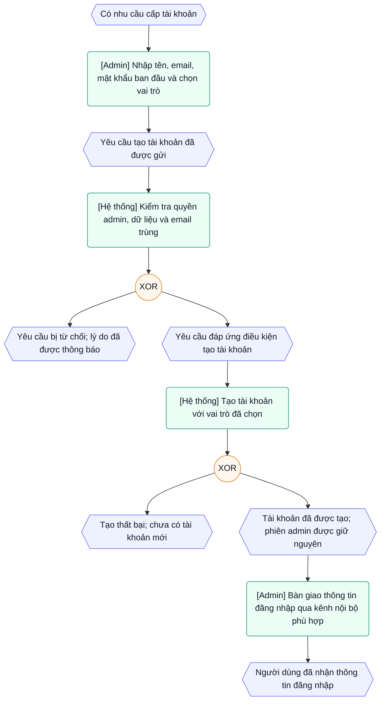

# Admin tạo tài khoản cho người dùng

Trạng thái: To-be, chưa triển khai.
Ngày ghi nhận: 2026-10-13.
Cập nhật: 2026-10-20.

## Mục tiêu

Ruvie Agent dùng mô hình tài khoản do công ty quản lý. Administrator, gọi tắt là admin, tạo tài khoản và chọn vai trò hệ thống cho người dùng. Admin bàn giao thông tin đăng nhập qua kênh nội bộ phù hợp.

Tài liệu này ưu tiên nghiệp vụ tạo tài khoản. Các hoạt động còn lại được ghi ngắn gọn trong [backlog administrator](administrator-operations.md). Chưa đề xuất thiết kế code, API hoặc schema.

## EPC — Admin tạo tài khoản

EPC (Event-driven Process Chain) mô tả chuỗi sự kiện và hoạt động nghiệp vụ. Hình lục giác là sự kiện/trạng thái. Ô bo góc là hoạt động. Vòng tròn XOR chỉ cho phép một nhánh xảy ra. Nhãn trong ngoặc vuông xác định bên thực hiện.

Sơ đồ thể hiện một lần xử lý yêu cầu. Sau lỗi, admin có thể sửa thông tin rồi gửi lại. Đăng nhập bằng tài khoản mới là bước kiểm chứng kết quả, không thay phiên đăng nhập dùng để tạo tài khoản.

## Phạm vi

### Bao gồm

- Admin mở **Quản trị → Người dùng → Tạo tài khoản**.
- Admin nhập thông tin và chọn vai trò `user` hoặc `admin`.
- Hệ thống kiểm tra quyền, dữ liệu, email trùng và thông báo kết quả tạo.
- Admin bàn giao thông tin đăng nhập; người nhận có thể đăng nhập sau đó.

### Chưa bao gồm

- Khởi tạo admin đầu tiên và khôi phục khi không còn admin.
- Sửa thông tin, đổi vai trò, tạm ngừng hoặc xóa tài khoản đã có.
- Cấp quyền project, tài liệu, model hoặc công cụ trong form tạo tài khoản.
- Quên mật khẩu, reset mật khẩu thay người dùng và tự đổi mật khẩu.
- Lời mời qua email, nhập tài khoản hàng loạt hoặc bắt buộc đổi mật khẩu ở lần đăng nhập đầu.

Các phần này thuộc [backlog administrator](administrator-operations.md).

## Điều kiện bắt đầu

- Hệ thống đã có admin; người thực hiện đang đăng nhập bằng tài khoản admin.
- Quyền admin hệ thống tách riêng với vai trò nghề nghiệp trong từng project.
- Admin đã có thông tin cần thiết và kênh bàn giao cho người nhận.
- Đăng ký công khai vẫn đóng khi hệ thống đã có tài khoản. Admin cấp thêm tài khoản qua chức năng quản trị, không bật lại đăng ký.

## Thông tin và vai trò

| Trường | Quy tắc nghiệp vụ |
| --- | --- |
| Tên hiển thị | Bắt buộc; không chấp nhận tên rỗng hoặc chỉ có khoảng trắng |
| Email | Bắt buộc; đúng định dạng; không trùng tài khoản đã có, kể cả khác chữ hoa/thường |
| Mật khẩu ban đầu | Bắt buộc; đáp ứng chính sách mật khẩu của Ruvie Agent |
| Vai trò hệ thống | Chọn `user` hoặc `admin`; mặc định là `user` |

| Vai trò được chọn | Kết quả sau khi tạo |
| --- | --- |
| `user` | Người dùng thông thường; không có quyền quản trị hệ thống |
| `admin` | Administrator; có quyền quản trị và tạo thêm tài khoản với một trong hai vai trò |

Admin được chọn cả hai vai trò trong cùng luồng tạo tài khoản. Không cần một quy trình riêng để tạo thêm admin. Lựa chọn `admin` phải nêu rõ người nhận sẽ có quyền quản trị hệ thống.

Cả hai vai trò đều không tự nhận membership project, vai trò nghề nghiệp hoặc quyền đọc tài liệu. Vai trò `admin` không mặc nhiên cho phép đọc mọi tài liệu.

## Luồng nghiệp vụ

1. Admin mở **Quản trị → Người dùng → Tạo tài khoản**.
2. Hệ thống hiển thị form rỗng với vai trò mặc định `user`.
3. Admin nhập tên, email, mật khẩu ban đầu và chọn vai trò.
4. Admin gửi yêu cầu tạo tài khoản.
5. Hệ thống xác minh người gửi vẫn có quyền admin; kiểm tra dữ liệu và email trùng.
6. Nếu yêu cầu hợp lệ, hệ thống tạo tài khoản với đúng vai trò đã chọn.
7. Hệ thống thông báo thành công và vai trò của tài khoản vừa tạo. Hệ thống xóa mật khẩu khỏi form; không trả lại mật khẩu đã lưu.
8. Admin bàn giao email đăng nhập và mật khẩu ban đầu qua kênh nội bộ phù hợp.
9. Người nhận đăng nhập bằng tài khoản được cấp. Quyền sau đăng nhập tương ứng với vai trò hệ thống và các quyền tài nguyên được cấp riêng.

Tạo tài khoản mới không đăng nhập thay người nhận, không đăng xuất admin và không thay danh tính của phiên admin đang mở.

## Tình huống lỗi

| Tình huống | Kết quả cần có |
| --- | --- |
| Chưa đăng nhập hoặc không còn quyền admin khi gửi | Từ chối; không tạo tài khoản, kể cả khi form đã mở từ trước |
| User thông thường truy cập trực tiếp chức năng tạo tài khoản | Từ chối; không cho phép tự chọn hoặc tự cấp vai trò admin |
| Thiếu trường bắt buộc, email sai hoặc mật khẩu không đạt chính sách | Báo rõ trường cần sửa; không tạo tài khoản |
| Vai trò ngoài `user`/`admin` | Từ chối; không tạo tài khoản với vai trò không hợp lệ |
| Email đã tồn tại | Báo trùng; không sửa tài khoản, mật khẩu hoặc vai trò đã có |
| Hai yêu cầu tạo cùng email đồng thời | Chỉ một tài khoản được tạo; yêu cầu còn lại nhận kết quả trùng email |
| Tạo tài khoản thất bại | Báo lỗi an toàn; không để lại tài khoản tạo dở |
| Mất phản hồi sau khi gửi | Chưa kết luận thành công/thất bại; kiểm tra tài khoản theo email trước khi gửi lại; không tạo bản trùng |
| Admin hủy trước khi gửi | Không tạo tài khoản và không giữ mật khẩu trong form đã đóng |

Thông báo và lịch sử hoạt động không chứa mật khẩu. Sau lỗi kiểm tra, admin có thể sửa thông tin; hệ thống không yêu cầu nhập lại các trường không nhạy cảm khi vẫn còn ở cùng form.

## Tiêu chí nghiệm thu nghiệp vụ

- [ ] Chỉ admin tạo được tài khoản; truy cập trực tiếp chức năng không vượt quyền.
- [ ] Form mặc định chọn `user`; admin có thể chọn `admin` và hiểu quyền đi kèm.
- [ ] Tài khoản được tạo có đúng vai trò đã chọn, đăng nhập được bằng thông tin đã cấp.
- [ ] User mới không truy cập được khu vực quản trị; admin mới truy cập được và tạo thêm tài khoản với vai trò `user` hoặc `admin`.
- [ ] Cả hai lựa chọn vai trò đều không tự cấp quyền project hoặc đọc tài liệu.
- [ ] Email trùng, kể cả khác chữ hoa/thường hoặc tạo đồng thời, không tạo bản trùng và không ghi đè tài khoản cũ.
- [ ] Dữ liệu hoặc vai trò không hợp lệ được báo rõ; yêu cầu bị từ chối không tạo tài khoản.
- [ ] Mất quyền admin trước lúc gửi khiến yêu cầu bị từ chối.
- [ ] Tạo thành công hoặc thất bại không đổi danh tính phiên admin đang dùng.
- [ ] Thành công/hủy form xóa mật khẩu khỏi form; phản hồi và thông báo không trả lại mật khẩu đã lưu.
- [ ] Tạo tài khoản thất bại không để lại tài khoản tạo dở.
- [ ] Không có thao tác bật lại đăng ký công khai trong luồng này.

Các mục trên là tiêu chí cho hành vi tương lai, chưa được đánh dấu hoàn thành.

## Tham khảo references

- [Form tạo người dùng](../../references/src/lib/components/admin/Users/UserList/AddUserModal.svelte): tham khảo tên, email, mật khẩu, vai trò và phản hồi sau khi tạo.
- [Luồng cấp tài khoản](../../references/backend/ruvie/routers/auths.py), `add_user`: tham khảo admin tạo tài khoản với vai trò được chọn, kiểm tra email/mật khẩu và ghi nhận bên thực hiện.
- [Kiểm tra admin](../../references/backend/ruvie/utils/auth.py), `get_admin_user`: tham khảo yêu cầu chỉ administrator được thực hiện.

Chỉ tham khảo hành vi phù hợp. Không đưa nhập CSV, vai trò `pending`, gán nhóm mặc định hoặc token đăng nhập của tài khoản mới vào phạm vi này. Quyền tài nguyên vẫn tuân theo chính sách default-deny của Ruvie Agent.
